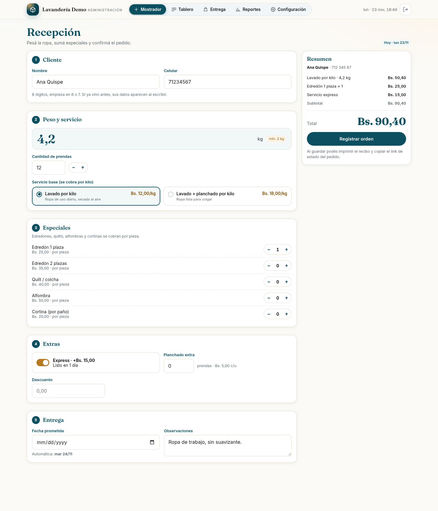
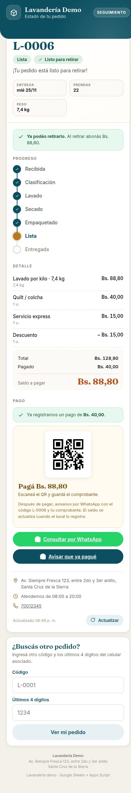

# Lavandería Demo · recepción, producción y entrega

Demo funcional de una lavandería por kilo sobre **Google Sheets + Google Apps Script**.
No necesita servidor ni base de datos: la hoja es la base y la Web App es el panel.

Pensada para mostrarse en una tablet o notebook en el mostrador, con el celular del
cliente como canal de consulta.

> `demo-lavanderia-ropa/` es la versión de **ropa**. La variante de autos se hará en
> `demo-lavanderia-autos/` reutilizando la misma arquitectura.

---

## Demo online

- **Panel + estado público (datos simulados)**: <https://demo-lavanderia-ropa.netlify.app>
  Se puede recorrer todo sin cuenta. Los datos viven en el navegador y se reinician al recargar.
- **Versión real**: se despliega sobre tu propia hoja de Google con Apps Script
  (ver *Puesta en marcha*).

---

## Capturas

### Panel del local



### Estado público en el celular

<p align="center">
  
</p>

---

## Qué incluye

- **Mostrador**: recepción por kilo, cantidad de prendas, especiales por pieza
  (edredones, quilts, alfombras, cortinas), planchado extra, express, descuento,
  fecha prometida automática y resumen en vivo.
- **Tablero de producción**: columnas por estado, KPIs, búsqueda, filtro de atrasadas,
  actualización silenciosa cada 30 s y detalle con línea de tiempo.
- **Entrega**: pedidos listos, cobro de saldo en efectivo o QR, confirmación de retiro,
  reimpresión de recibo y aviso al cliente.
- **Reportes** (admin): facturación, cobros, ticket promedio, prendas/kilos, saldo activo,
  cobros por día, por método y servicios vendidos.
- **Configuración** (admin): datos del local, precios, días de entrega y cerrados,
  colores, plantilla de WhatsApp, QR de pago, catálogo de servicios y datos de demo.
- **Recibo imprimible**: ticket de 80 mm o A4 según el navegador, con QR al estado público.
- **Estado público**: `?estado=TOKEN` con progreso, detalle, saldo y QR de pago.
  Sin teléfono, sin apellido y sin observaciones.
- **Recuperación**: código de orden + últimos 4 dígitos del celular.
- **Responsive**: panel y estado público probados en 320, 390, 768, 1024 y 1440 px.
  En móvil el tablero y los gráficos se desplazan en horizontal en lugar de aplastarse.

### Fuera de alcance (a propósito)

- Reparto a domicilio.
- Facturación fiscal.
- Modo offline.
- Multi-sucursal.
- Integraciones con balanzas o impresoras térmicas.
- API oficial de WhatsApp / automatización de envíos.

---

## Stack

| Pieza | Rol |
|---|---|
| Google Sheets | Base de datos (8 hojas) |
| Google Apps Script (V8) | Backend: auth, precios, estados, pagos, reportes |
| HTML Service | Panel admin + página pública de estado |
| `wa.me` | Aviso manual por WhatsApp, sin API ni costo por mensaje |
| clasp | Subida de archivos y deploys |

---

## Puesta en marcha

### 1. Crear la hoja y el proyecto

1. Creá una planilla nueva en Google Sheets.
2. Abrí **Extensiones → Apps Script**.
3. Copiá el `scriptId` del proyecto (Configuración del proyecto).

### 2. Subir el código con clasp

```bash
cd demo-lavanderia-ropa
npm install
cp .clasp.example.json .clasp.json
# Editá .clasp.json y reemplazá PEGAR_AQUI_EL_SCRIPT_ID por tu scriptId
npx clasp login
npm run push
```

Si no querés usar clasp, creá a mano los archivos `.js` y `.html` dentro del editor
de Apps Script respetando los nombres de `src/` y pegá el manifiesto en
`appsscript.json` (activando "Mostrar archivo de manifiesto").

### 3. Preparar la hoja

La Web App se inicializa sola en la primera visita autorizada: `bootstrapDemo_()`
crea las 8 hojas con sus encabezados, la configuración por defecto, el catálogo de
servicios y los PINs demo, y programa la carga de los 8 pedidos de ejemplo.

Si preferís preparar la hoja antes, ejecutá una vez en el editor:

```text
sembrarDemo()
```

Autorizá los permisos cuando lo pida. `setup()` también existe y hace lo mismo,
pero sin cargar pedidos de ejemplo.

### 4. Publicar la Web App

En Apps Script: **Implementar → Nueva implementación → Aplicación web**.

- **Ejecutar como**: yo (`USER_DEPLOYING`).
- **Quién tiene acceso**: cualquier persona (`ANYONE_ANONYMOUS`).

La página pública de estado necesita acceso anónimo. El panel pide PIN igual.

La **primera visita** debe hacerla la cuenta dueña del script para autorizar los
permisos de Sheets y Drive. Después la URL queda pública para cualquiera.

La URL queda así:

```text
https://script.google.com/macros/s/AKfycb.../exec          → panel
https://script.google.com/macros/s/AKfycb.../exec?estado=TOKEN → estado público
```

### 5. Deploys siguientes

```bash
npm run push
npx clasp deploy -d "demo"     # primera vez: anotá el deploymentId
export CLASP_DEPLOYMENT_ID="AKfycb..."   # pegá el ID
npm run deploy                 # actualiza el deployment sin cambiar la URL
```

`scripts/deploy.mjs` hace `push --force` y actualiza el deployment existente si
`CLASP_DEPLOYMENT_ID` está definido.

---

## Acceso

| Rol | PIN demo | Puede ver |
|---|---|---|
| Mostrador (`staff`) | `1357` | Mostrador, Tablero, Entrega |
| Administración (`admin`) | `2468` | Todo + Reportes + Configuración |

Los PINs se guardan en **Propiedades del script** como `ADMIN_PIN` y `STAFF_PIN`.
Cambialos antes de usar datos reales:

```text
Administración del proyecto → Configuración → Propiedades del script
```

Hay bloqueo de 6 intentos fallidos por rol durante 5 minutos.
La sesión dura 6 horas (máximo de `CacheService`).

---

## Flujo de trabajo

```text
Recepción (mostrador)
  └─ se pesa, se cargan especiales y se registra el pedido
       └─ Tablero: recibida → clasificación → lavado → secado
            → planchado* → empaquetado → lista
                 └─ Entrega: aviso por WhatsApp, cobro y retiro
                      └─ entregada
```

`planchado` se saltea automáticamente si el servicio no incluye planchado y no se
agregó planchado extra.

### Reglas de negocio

- **Precio congelado**: las líneas guardan precio unitario y subtotal al crear la orden.
  Cambiar la lista de precios no altera pedidos existentes.
- **Mínimo por orden**: si el peso real es menor, se cobra el mínimo configurado
  (por defecto 2 kg).
- **Tipos de línea**: `general_kg`, `especial_pieza`, `planchado_pieza`, `recargo`
  y `descuento`.
- **Pago parcial**: se puede cobrar una parte; `pago_estado` pasa a `parcial` y luego
  a `pagado`.
- **Entrega bloqueada**: no se puede pasar a `entregada` con saldo mayor a Bs. 0,005.
- **Cancelación**: solo antes de empezar el lavado y solo si no hay pagos registrados.
- **Retroceso**: solo administración, un paso por vez y con motivo.
- **Fecha prometida**: se calculan días hábiles salteando `dias_cerrados`.
  Si `dias_cerrados` está vacío, se entrega todos los días.

---

## WhatsApp sin API

El aviso es **manual y transparente**:

1. En *Entrega* o en el detalle del tablero, tocá **Avisar por WhatsApp**.
2. La app arma el mensaje con la plantilla configurada y el link de estado.
3. Se abre `wa.me` con el texto ya escrito.
4. La persona toca **Enviar** en su teléfono.
5. Al volver, toca **Ya lo envié** y queda registrado en `Notificaciones` y `Eventos`.

No hay Meta Business, ni tokens, ni costo por mensaje. También existe **Copiar mensaje**
para pegar en otro canal.

Placeholders disponibles en la plantilla:

```text
{cliente} {codigo} {negocio} {total} {saldo} {pendiente}
{prendas} {peso} {link} {direccion} {horario} {fecha_prometida}
```

---

## Estado público y QR

Cada orden tiene un `token` aleatorio de 24 caracteres. El recibo imprime un QR
(QuickChart, solo demo) que apunta a:

```text
.../exec?estado=TOKEN
```

La página pública muestra:

- primer nombre del cliente y código;
- estado actual, descripción y progreso;
- fecha prometida, prendas y peso;
- detalle de líneas y totales;
- saldo y QR de pago si corresponde;
- botón de WhatsApp del local.

**No muestra** teléfono, apellido completo, observaciones ni datos internos.

Si el cliente perdió el link, puede recuperarlo con **código + últimos 4 dígitos**
del celular. Hay límite de 10 intentos cada 10 minutos por código.

---

## Estructura de la hoja

| Hoja | Contenido |
|---|---|
| `Config` | Clave/valor: negocio, precios, colores, plantilla, QR |
| `Servicios` | Catálogo por kilo y por pieza, activo/inactivo |
| `Clientes` | Nombre, teléfono, última visita |
| `Ordenes` | Cabecera: estado, totales, pago, fechas, token |
| `OrdenLineas` | Detalle con precio congelado |
| `Eventos` | Historial de estados, pagos y avisos |
| `Pagos` | Cobros con método, monto y usuario |
| `Notificaciones` | Avisos enviados o copiados |

No renombres las hojas ni los encabezados: el backend los usa como contrato.
`setup()` agrega encabezados faltantes sin borrar datos existentes.

### Precios de demo

| Servicio | Precio |
|---|---|
| Lavado por kilo | Bs. 12/kg |
| Lavado + planchado | Bs. 18/kg |
| Edredón 1 plaza | Bs. 25 |
| Edredón 2 plazas | Bs. 35 |
| Quilt / colcha | Bs. 40 |
| Alfombra | Bs. 50 |
| Cortina (por paño) | Bs. 20 |
| Planchado extra | Bs. 5/pieza |
| Express | + Bs. 15 |
| Mínimo por orden | 2 kg |

---

## Configuración

Desde **Configuración** (admin) se editan:

- nombre, ciudad, dirección, WhatsApp, teléfono y horario;
- mínimo por orden, recargo express y planchado extra;
- días de entrega para lavado, planchado y express;
- días cerrados (chips de lunes a domingo);
- colores de la app;
- plantilla de WhatsApp, URL del QR e instrucciones de pago;
- pie de página del recibo;
- catálogo de servicios: crear, editar, activar/desactivar.

`zona_horaria`, `moneda` y `moneda_simbolo` se cambian directamente en la hoja `Config`.

### Datos de demo

- **Cargar datos de ejemplo**: crea 8 pedidos si la hoja está vacía.
- **Limpiar caché**: fuerza a releer configuración y catálogo.
- **Reiniciar demo**: borra pedidos, líneas, eventos, pagos y avisos; vuelve a cargar
  los 8 ejemplos. Clientes y servicios se conservan.

---

## Desarrollo

```bash
npm install     # dependencias de clasp y tipos (solo para deploy/editor)
npm run check   # sintaxis de Codigo.js y Operaciones.js
npm test        # 20 pruebas de backend con mocks de Apps Script
```

Las pruebas corren con el runner nativo de Node y `TZ=America/La_Paz`.
No necesitan credenciales ni conexión a Google.

### Demo estático (Netlify)

`npm run demo` genera una copia navegable en `.preview/` con datos simulados.
`npm run demo:netlify` genera `dist/`, lista para `netlify deploy --dir dist --prod`.
El backend real no corre en Netlify: `google.script.run` se reemplaza por
`scripts/demo-mock.js` y los datos viven en memoria.

### QA aplicado

- Backend: 20 pruebas sobre precios, mínimos, estados, planchado condicional,
  pagos, entrega con saldo, cancelación, fechas hábiles y estado público.
- Flujos completos en navegador: login por PIN, alta de pedido, avance de estados,
  cobro total/parcial con QR, aviso por WhatsApp, recibo imprimible, reportes,
  configuración y recuperación de estado público.
- Responsive verificado en 320, 390, 768, 1024 y 1440 px, sin desborde horizontal.
- Los 11 archivos HTML se validan con parseo de sus bloques `<script>`.

### Archivos

| Archivo | Responsabilidad |
|---|---|
| `src/Codigo.js` | Infra: hojas, config, auth, setup, helpers |
| `src/Operaciones.js` | Precios, órdenes, estados, pagos, avisos, reportes, demo |
| `src/Admin.html` | Shell del panel, login, navegación y `window.BOOT` |
| `src/AppCore.html` | Cliente API, router, helpers de UI, recibo imprimible |
| `src/Componentes.html` | Modales de pago, aviso, texto y portapapeles |
| `src/EstiloBase.html` | Tokens y componentes base |
| `src/EstiloApp.html` | Estilos del panel |
| `src/VistaMostrador.html` | Recepción por kilo |
| `src/VistaTablero.html` | Producción y detalle |
| `src/VistaEntrega.html` | Retiro y cobro |
| `src/VistaReportes.html` | Reportes |
| `src/VistaConfiguracion.html` | Ajustes y catálogo |
| `src/Estado.html` | Página pública de estado |
| `tests/backend.test.mjs` | Pruebas de backend con VM y mocks |
| `scripts/deploy.mjs` | Push + deploy conservando la URL |
| `scripts/build-demo.mjs` | Build del demo estático para Netlify |
| `scripts/demo-mock.js` | Mock de `google.script.run` para el demo estático |
| `netlify.toml` | Build y publish del demo en Netlify |
| `assets/` | Capturas del panel y del estado público para el README |

---

## Seguridad y límites

- Los PINs de demo (`2468` / `1357`) son **solo para la demo**.
- Las sesiones viven en `CacheService` (6 h). No hay usuarios individuales.
- La sesión se guarda en `sessionStorage`; cerrar la pestaña la borra.
- El backend valida rol en cada llamada, no solo en la UI.
- La página pública sanitiza los datos antes de responder.
- Las escrituras a Sheets fuerzan formato texto para evitar inyección de fórmulas.
- El QR del recibo usa QuickChart (servicio externo). Para producción, alojá tu propia
  imagen y actualizá el campo `pago_qr_url`.

### Limitaciones conocidas

- No hay edición de una orden ya creada (solo retroceder estado y cancelar antes del lavado).
- El cobro es manual: la app registra lo que confirma el personal, no verifica
  transferencias reales.
- El estado público se actualiza al abrirlo o cada 60 s mientras esté visible.
- El demo no incluye entrega a domicilio ni facturación.
- No hay control de concurrencia por fila más allá del `LockService` al crear órdenes.

---

## Próximos pasos posibles

- Edición de peso/prendas con auditoría.
- Etiquetas con código de barras.
- Entrega a domicilio con repartidores.
- Recordatorio automático de pedidos listos.
- Exportación CSV de reportes.
- Tests de UI con Playwright.
